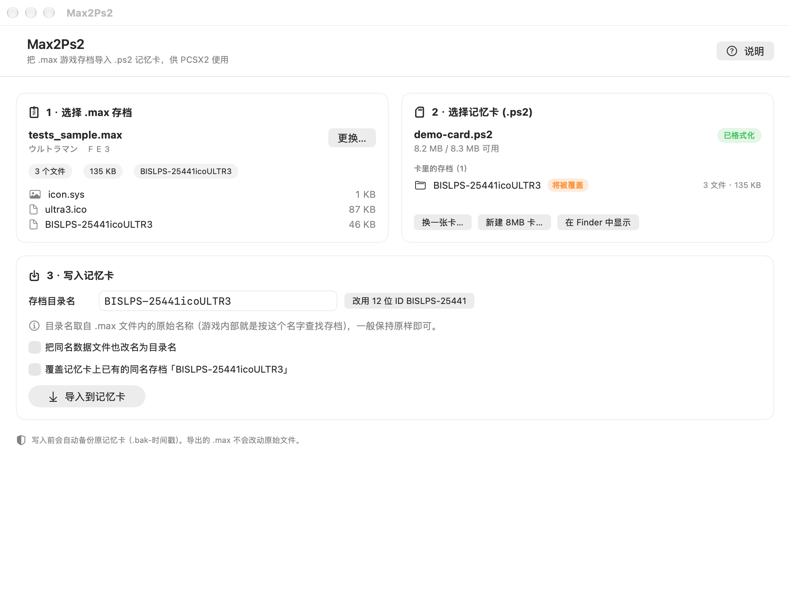

# Max2Ps2

把 **.max 格式的 PS2 游戏存档**导入 **.ps2 记忆卡文件**，供 PCSX2 模拟器使用。

原生 Swift + SwiftUI 写的 macOS App，不依赖 Python、mymc 或其他第三方工具，也不联网。



## 系统要求

- macOS 14 (Sonoma) 或更高版本
- Apple Silicon / Intel 均可

## 构建

```bash
cd Max2Ps2
./build.sh          # 构建 Release 版：Dist/Max2Ps2.app 与 Dist/Max2Ps2.zip
./build.sh run      # 构建后直接启动
```

产物是 ad-hoc 签名的本地 App（没有开发者证书），第一次打开如果被系统拦截：
右键点击 App →「打开」，或在「系统设置 → 隐私与安全性」里选择「仍要打开」。

## 使用步骤

1. **选择 .max 存档**：把文件拖进左侧区域，或点「选择文件…」。
   支持 Datel MAX Drive 的 `Ps2PowerSave` 格式（扩展名通常是 `.max`）。

2. **选择记忆卡**：拖入 PCSX2 的记忆卡文件，默认位置是：

   ```
   ~/Library/Application Support/PCSX2/memcards/Mcd001.ps2
   ```

   - 卡是全新的、或从没格式化过（PCSX2 新建的空白卡）→ 点「格式化为 8MB 卡」。
   - 也可以点「新建 8MB 记忆卡…」直接生成一张新卡。

3. **确认存档目录名**，然后点「导入到记忆卡」。

   目录名默认取 .max 文件里的原始名称，**一般不用改**——不少游戏（例如《奥特曼格斗进化 3》）
   的存档目录并不是 12 位游戏 ID，而是 `BISLPS-25441icoULTR3` 这样的内部名字，改了反而读不到。
   只有确认自己的游戏用 12 位 ID 时，才点「改用 12 位 ID」。
   如果游戏里看不到存档，可以两种名字各试一次。

完成后重新启动 PCSX2，进入游戏读取记忆卡即可。

## 注意事项

- **导入前请先完全退出 PCSX2**。PCSX2 运行时记忆卡内容在内存里，退出时会整卡写回，
  会把刚导入的存档覆盖掉。
- **每次写卡前会自动备份**：同目录下生成 `Mcd001.ps2.bak-20261106-133012` 这样的副本，
  出问题可以改回原名恢复。
- 只支持标准 **8MB** 记忆卡（PCSX2 默认规格，8,650,752 字节）。如果手上的卡是
  16/32/64MB，请先在 PCSX2 里新建一张 8MB 卡再导入。
- 导出的 .max 原文件不会被修改。

## 命令行工具（可选，调试用）

源码里带了一个小 CLI，方便排查问题：

```bash
swiftc -O -module-cache-path .build/modulecache \
    Sources/Core/*.swift Tools/main.swift -o .build/verify

./.build/verify info    存档.max              # 查看 .max 内容
./.build/verify format  卡.ps2                # 格式化 8MB 卡
./.build/verify list    卡.ps2                # 列出卡内存档
./.build/verify import  存档.max 卡.ps2       # 导入
./.build/verify extract 卡.ps2 目录名 输出目录 # 导出卡内存档
./.build/verify ecc     卡.ps2                # 校验 ECC
```

## 实现说明

- `.max`：92 字节头（magic `Ps2PowerSave`、目录名、icon.sys 名、压缩/解压长度）+ LZARI
  压缩的文件表；解压后每项是 `u32 长度 + 32 字节文件名 + 数据`，并按 16 字节对齐。
- 记忆卡：按 PS2 官方布局写 superblock、间接 FAT 表、FAT、目录项（dirent）与数据簇，
  每页按 128 字节一组重算 ECC 写入 spare 区。格式化结果与 mymc/mymcplus 生成的卡
  逐字节一致（仅时间戳秒数不同）。
- 已验证：用 mymcplus 检查导入后的卡无错误，导出的文件与原 .max 内文件 SHA-256 完全一致。

## 目录结构

```
Max2Ps2/
├── Sources/
│   ├── Core/          # 格式解析与记忆卡读写（无 UI 依赖）
│   │   ├── LZARI.swift
│   │   ├── MaxSave.swift
│   │   ├── MemoryCard.swift
│   │   ├── PS2ECC.swift
│   │   └── Support.swift
│   └── App/           # SwiftUI 界面
├── Tools/             # 调试用 CLI 与模型测试
├── build.sh
└── Max2Ps2.xcodeproj
```
